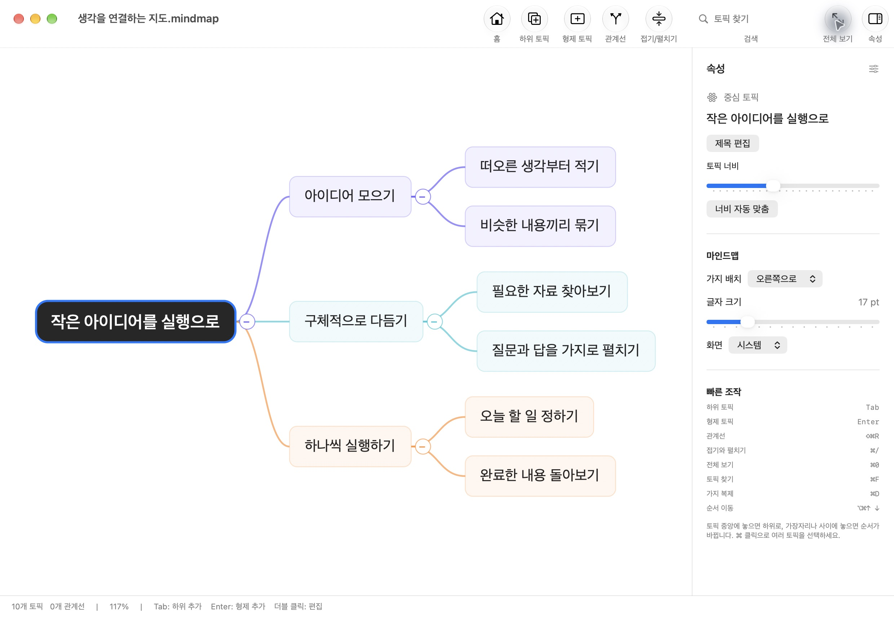
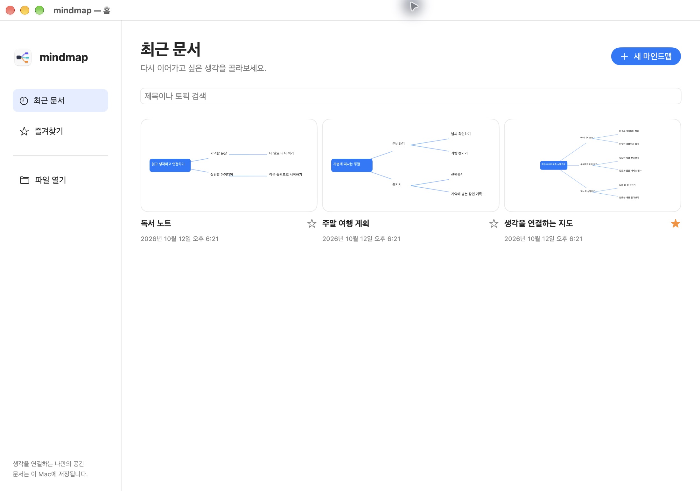

<p align="center">
  
</p>
<h1 align="center">mindmap</h1>
<p align="center">
  생각을 가지로 펼치고 서로 연결하는 Mac 앱.<br>
  로그인이나 구독 없이, 내 문서를 내 Mac에 저장합니다.
</p>
<p align="center">
  <a href="#시작하기">시작하기</a> |
  <a href="docs/usage.md">사용 안내</a> |
  <a href="docs/development.md">개발 안내</a>
</p>

<p align="center">
  <a href="docs/assets/editor.png"></a>
</p>
<p align="center">생각 하나에서 시작해 필요한 만큼 가지를 펼쳐보세요.</p>

## 이렇게 사용해요

1. 홈에서 새 마인드맵을 만들고 중심 토픽에 생각을 적습니다.
2. **Tab**으로 하위 토픽을, **Enter**로 형제 토픽을 추가합니다. 편집 중 Enter는 입력을 마치고, Shift+Enter는 줄을 바꿉니다.
3. 토픽을 드래그해 순서를 바꾸거나 다른 토픽 아래로 옮깁니다. 서로 관련 있는 생각은 관계선으로 연결합니다.
4. **⌘S**로 저장 위치를 정합니다. 이후 변경 내용은 자동 저장되고, 홈에서 문서를 다시 열 수 있습니다.

## 주요 기능

- **흐름을 이어가는 글쓰기** — 토픽 선택 후 바로 입력, 여러 줄 텍스트, 내용에 맞춘 크기 조절과 토픽별 너비 설정.
- **자유로운 재구성** — 드래그로 순서와 부모 토픽 변경, 여러 가지 선택, 복사와 붙여넣기, 복제와 실행 취소.
- **생각 사이의 연결** — 관계선에 설명을 쓰고 화살표 방향과 곡선을 조절.
- **다시 찾기 쉬운 홈** — 문서 미리보기, 즐겨찾기, 제목과 토픽 내용 검색.
- **내게 맞는 보기** — 오른쪽 또는 양쪽 배치, 가지 접기, 확대와 화면 이동, 글자 크기와 밝은 화면 또는 어두운 화면.

<p align="center">
  <a href="docs/assets/home.png"></a>
</p>
<p align="center">최근 문서를 미리 보고, 자주 여는 문서는 즐겨찾기로 모아두세요.</p>

## 시작하기

**macOS 26 이상, Swift 6과 macOS SDK가 포함된 Xcode**가 필요합니다. 현재는 소스에서 빌드해 사용하는 앱입니다.

```sh
git clone https://github.com/zzoe2346/mindmap.git
cd mindmap
./scripts/package.sh
open dist/mindmap.app
```

빌드된 `dist/mindmap.app`을 원하는 위치로 복사해 사용할 수 있습니다.
외부 패키지나 서버는 필요하지 않습니다. 빌드 과정과 검사 방법은 [개발 안내](docs/development.md)를 참고하세요.

## 문서와 데이터

문서는 직접 선택한 위치에 `.mindmap` 파일로 저장합니다. 계정, 구독과 클라우드 연결은 필요하지 않습니다.
XMind 파일 가져오기는 지원하지 않습니다.

위 이미지는 공개용 예제 문서를 넣어 실제 앱에서 촬영했습니다. 촬영 환경과 출처는 [캡처 기록](docs/assets/screenshots.json)에 남겼습니다.

## 개발 문서

[사용법](docs/usage.md) |
[요구사항](docs/requirements.md) |
[화면 설계](docs/design.md) |
[내부 구조](docs/lld.md) |
[검증 기록](docs/qa.md)
